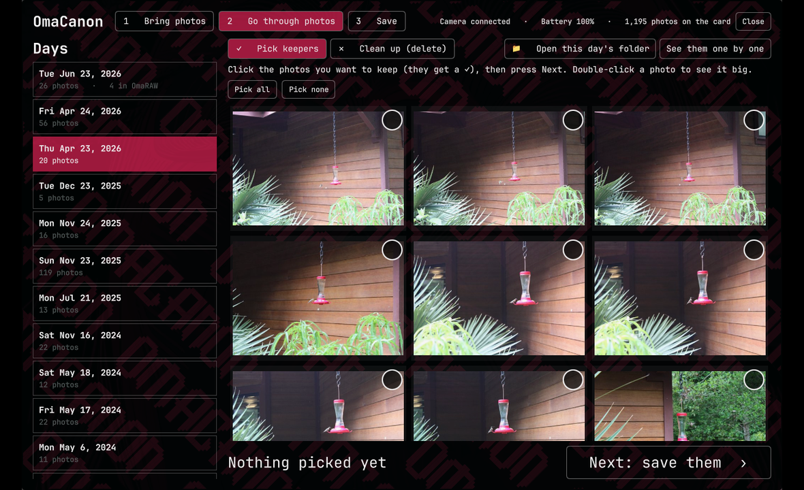
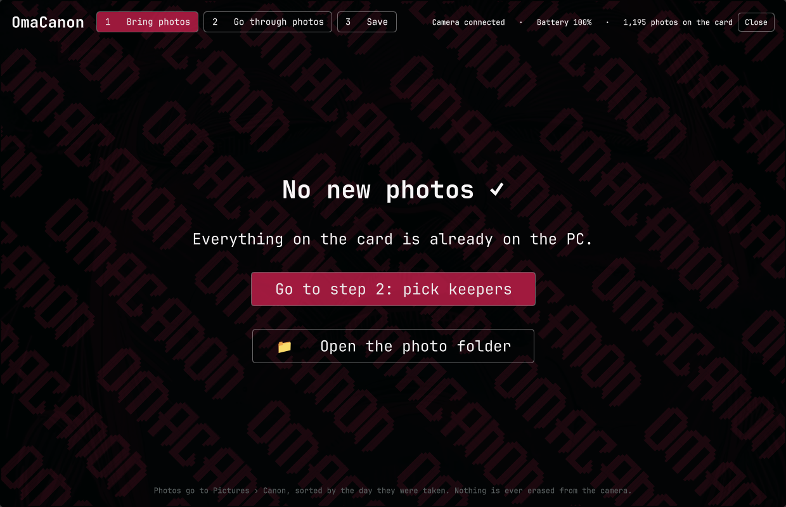
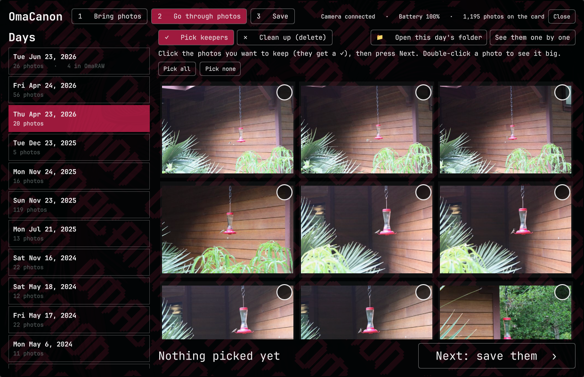
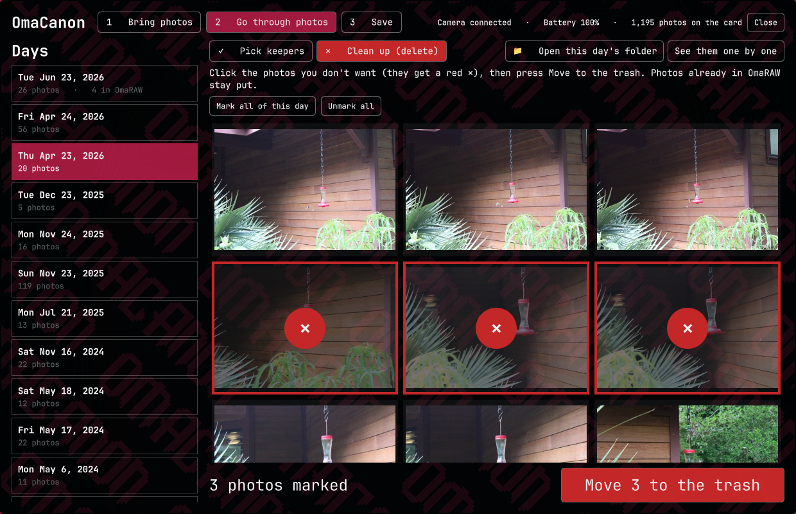
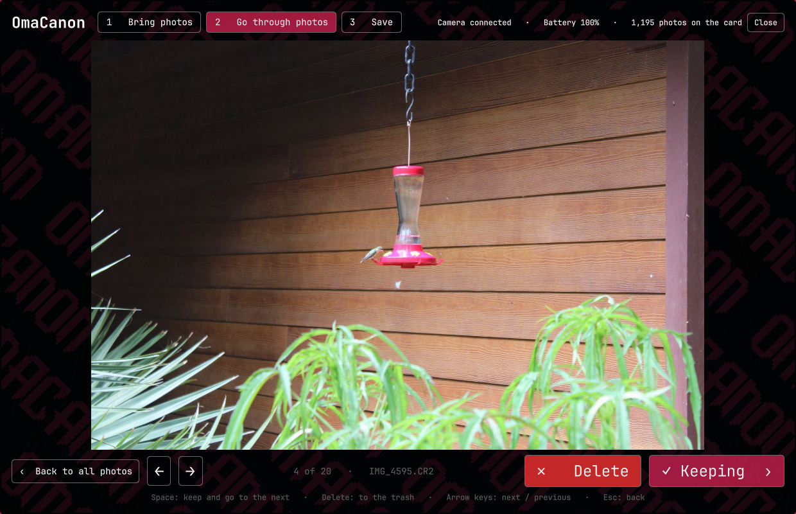
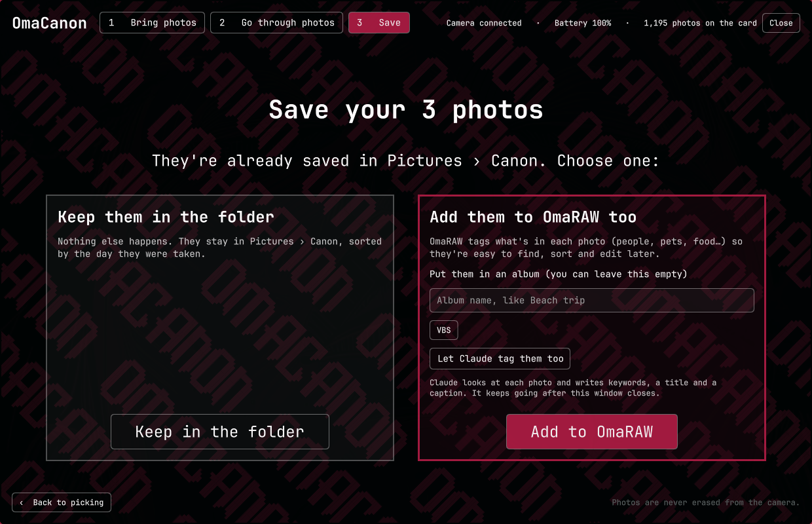

# OmaCanon

a plug and play Canon camera manager for [Omarchy](https://omarchy.org).

plug the camera in by usb and the window pops open by itself and pulls every new photo over to `~/Pictures/Canon`, sorted into folders by the day they were taken. RAW photos get big previews made right away, so you can flip through them fast, toss the bad ones, and save the keepers. the keepers can go straight into [OmaRAW](https://github.com/28allday/omaraw) with tags and an album so they're easy to find and edit later.

nothing ever gets erased off the camera.



## what it does

it's one big window in the middle of the screen that walks you through three steps.

**1. bring photos.** plug in the camera and turn it on. everything that isn't on the PC yet comes over by itself, with a progress bar and how long it's got left. you can start going through the first days while the rest are still coming. photos you already brought over never come back, even if you deleted them.



**2. go through photos.** days on the left, that day's photos on the right. two ways to work:

- **pick keepers**: click the ones you want to keep, they get a ✓.
- **clean up**: click the ones you don't want, they get a red ✕, then one button moves them all to the trash. there's a "mark all of this day" for the days where everything came out blurry.





**see them one by one** opens the big view. space keeps it and goes to the next one, delete trashes it and goes to the next one, arrows to move around. that's the fastest way through a big day.



delete moves the real file to the system trash, so you can still get it back from the file manager until you empty the trash.

**3. save.** two choices:

- **keep them in the folder**: they're already saved by date, nothing else happens.
- **add them to OmaRAW too**: OmaRAW's own tagger labels what's in them (people, pets, food, cars… 80 kinds of things), and you can put them in an album. there's also an optional **let Claude tag them too** button, see [Claude tagging](#claude-tagging-optional) below.



there's a big **open the photo folder** button too. folders open on top of the window so nothing gets lost behind it. the photos are normal files with their original names, so any photo app (darktable, RawTherapee, digiKam, GIMP) can open them from there.

## cameras

it works with Canon cameras over usb. the previews come out of the photo itself, so it depends on what kind of RAW your camera shoots.

**tested:**
- Canon EOS Rebel T7 (EOS 2000D, Kiss X90)

**should work** (Canons that shoot CR2 RAW or JPEG, and talk over usb the same way as the T7):
- Rebel T3, T5, T6, T100 (1100D, 1200D, 1300D, 4000D)
- Rebel T3i, T4i, T5i, T6i, T6s, T7i (600D, 650D, 700D, 750D, 760D, 800D)
- Rebel SL1, SL2 (100D, 200D), 77D
- 60D, 70D, 80D, 7D, 7D Mark II
- 6D, 6D Mark II, 5D Mark III, 5D Mark IV
- PowerShot and IXUS cameras that save JPEGs

**might work, but no previews yet** (newer Canons that shoot CR3 RAW). the photos still come over into the right day folders, the grid just shows blank tiles for the CR3 files. JPEGs from these show fine.
- EOS R, RP, R5, R6, R7, R8, R10, R50, R100
- EOS M50, M6 Mark II
- 90D, Rebel SL3, T8i (250D, 850D)

**won't work:** very old Canons from before about 2004 that don't speak the standard camera protocol (PTP) over usb.

if yours isn't on the list, try it. if `gphoto2 --auto-detect` sees the camera, OmaCanon should too. videos are skipped, it only brings photos.

## install

you need Omarchy 4, the camera's usb cable, and these packages: `gphoto2`, `python`, `python-pillow`, `util-linux`.

```bash
omarchy plugin add https://github.com/Dankestrick/OmaCanon.git --enable
```

that's it, nothing needs root.

**on the camera, once:** if it has wifi, turn it off. with wifi on, the camera blocks usb. on the T7 that's MENU › wrench tab › Wi-Fi/NFC › Disable.

## open it

plug in the camera and turn it on, it opens by itself. or:

```bash
omarchy-shell shell toggle io.github.dankestrick.omacanon '{}'
```

to open on a step, pass `'{"tab":"photos"}'` (`camera`, `photos`, `save`). `Esc` or SUPER + W closes it.

you can put it on a key. add a line like this to `~/.config/hypr/bindings.lua`:

```lua
o.bind("SUPER + SHIFT + C", "OmaCanon", "omarchy-shell shell toggle io.github.dankestrick.omacanon '{}'")
```

## OmaRAW

OmaRAW is optional. without it, steps 1 and 2 and "keep them in the folder" work the same.

- close the OmaRAW window before you save to it. OmaRAW only lets one copy open its library at a time, and the app tells you if it's open.
- only the photos you pick go in. OmaCanon never sets up a watched folder, so OmaRAW doesn't fill up with every blurry shot.
- it switches OmaRAW's automatic tagging on for the import and puts the switch back how you had it after.
- stars, flags and color labels stay yours. OmaCanon never touches them.

## Claude tagging (optional)

if you have [Claude Code](https://claude.com/claude-code) installed and signed in, step 3 shows a **let Claude tag them too** button. Claude looks at each photo and writes keywords, a title and a caption into OmaRAW, like "Hummingbird at the porch feeder" with *hummingbird, bird feeder, porch, plants*. it runs in the background, so you can close the window. it never guesses anyone's name.

what you should know before you turn it on:

- it **sends a smaller copy of each photo (1024 px JPEG) to Anthropic** through your own Claude Code login, and it uses your Claude plan (about $0.003 a photo, so roughly $3 per 1,000).
- it only happens for the photos you picked, and only when you turn the button on. nothing gets sent otherwise.
- Claude only gets permission to read the folder of small copies. no shell, no web tools, no other files. it answers with words, and OmaCanon writes them into OmaRAW itself. the copies get deleted right after.

if `claude` isn't installed, the button doesn't show.

## streaming with it too

if you also use the [DSLR Webcam](https://github.com/amagdy46/omarchy-dslr-webcam) plugin to use the camera as a webcam, only one of them can have the camera at a time. while the webcam is switched on, OmaCanon leaves the camera alone and shows a **turn the webcam off** button. that switches it off and starts bringing photos over. keep the webcam off when you're not streaming, so plugging the camera in goes to photos.

## where stuff lives

- photos: `~/Pictures/Canon/<year>/<year-month-day>/`, original file names
- what's been brought over and sent: `~/.local/state/omacanon/`
- previews: `~/.cache/omacanon/`

## Permissions and safety

OmaCanon runs as a normal Omarchy plugin, with your user's permissions.

- **No root steps.** OmaCanon does not use sudo or pkexec. It installs no services and no udev rules.
- **Seeing the camera.** A `udevadm monitor` watches for usb devices coming and going while the shell runs. To check whether a Canon (usb vendor `04a9`) camera is there, it only reads sysfs.
- **What it runs.** Its own helper (`helpers/omacanonctl`, plain Python), always with argument lists, never through a shell. The helper runs `gphoto2` to list and download photos (read only: it never deletes or changes anything on the camera), `gio trash` for delete, `xdg-open` to open a folder, `hyprctl` to float that window on top, `omaraw --headless` to save to OmaRAW, and `claude` only when you turn on Claude tagging. A download that stops answering for 3 minutes gets ended.
- **The DSLR Webcam plugin.** It reads `systemctl --user is-active dslr-webcam.service` and `dslr-webcam status` to know if the webcam has the camera. It only runs `dslr-webcam off` when you press **turn the webcam off**.
- **What it writes.** Photos into `~/Pictures/Canon/`. Its lists into `~/.local/state/omacanon/` and previews into `~/.cache/omacanon/`, both private to you (folders 0700, list files 0600).
- **What it deletes.** Only the photos you delete, into the system trash, and only from inside `~/Pictures/Canon/`. Plus its own previews and temp files.
- **Network.** None, except the optional Claude tagging above.

## if something's off

| what you see | fix |
| --- | --- |
| "Plug in the camera" but it's plugged in | turn the camera's wifi off, then unplug and replug. check `gphoto2 --auto-detect` sees it. |
| "Another program is using the camera" | close anything else using it (OmaRAW's capture tab, the webcam, a file manager that mounted it). |
| "The camera didn't answer" | turn the camera off and on, then **try again**. it picks up where it stopped. |
| "Close the OmaRAW window first" | close OmaRAW, then save again. |
| blank tiles in step 2 | that's a CR3 camera, see [cameras](#cameras). the photos are fine. |

## remove

```bash
omarchy plugin remove io.github.dankestrick.omacanon --yes
```

Omarchy keeps a backup copy named `~/.config/omarchy/plugins/.io.github.dankestrick.omacanon.bak.<date>`, which you can delete. to remove its lists and previews too:

```bash
rm -rf ~/.local/state/omacanon ~/.cache/omacanon
```

your photos in `~/Pictures/Canon` stay put.

OmaCanon isn't made by or affiliated with Canon.

## license

[MIT](LICENSE)
